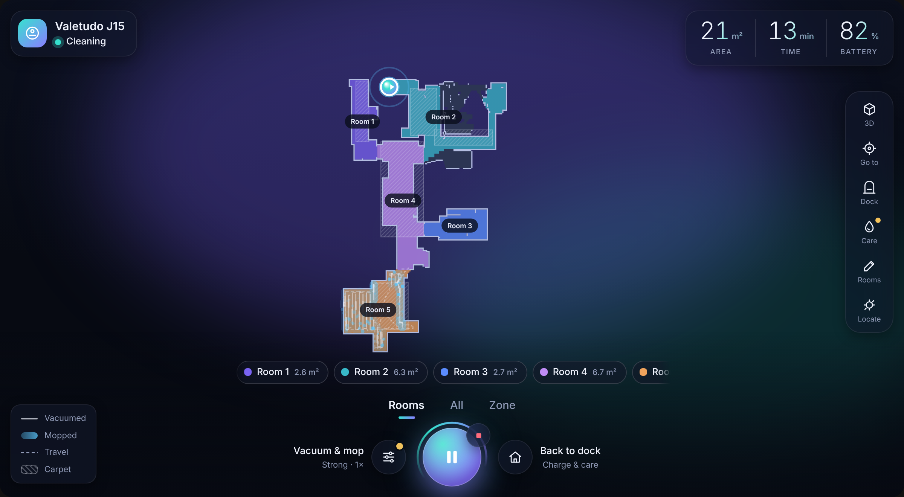
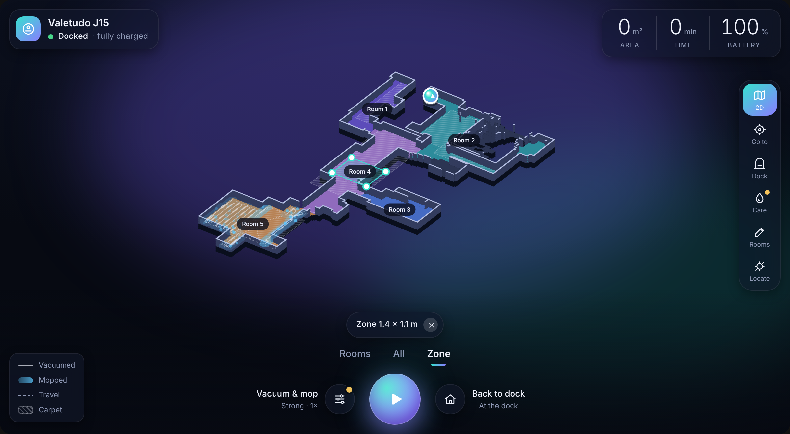
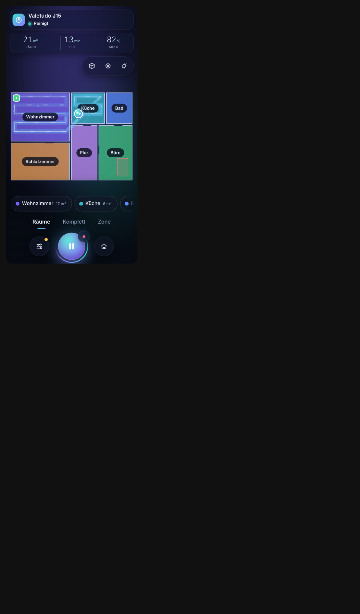
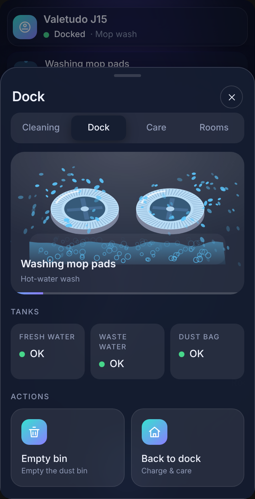
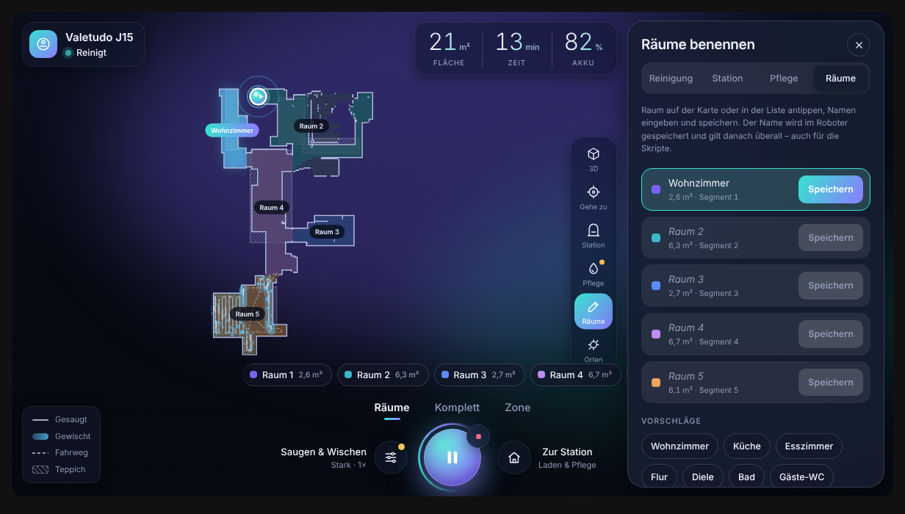

# Eureka 15 Pro Ultra Vacuum Card

A Lovelace card for Valetudo robot vacuums (built for the Eureka J15 Pro Ultra): live map with 2D/3D view, room and zone cleaning, go-to, a water trail for mopped areas, dock animations, consumables, cameras (including the robot's own camera), a room-name editor and a joystick for manual control (with the Valetudo Control integration). Optimized for desktop, kiosk and phone. Fully local.



 

## Install

**Marketplace (Home Assistant 2026.11+):** Settings → Marketplace → *Add from link* → paste this repository's URL → install **Vacuum Card** → reload the browser. The dashboard resource is added automatically.

**Manual:** copy `vakuum-card.js` to `/config/www/vakuum-card/` and add the resource `/local/vakuum-card/vakuum-card.js` (JavaScript module).

## Configure

```yaml
type: custom:vakuum-card          # custom:vacuum-card works too
entity: vacuum.valetudo_talltotalfalcon   # your Valetudo vacuum entity
topic: valetudo/TallTotalFalcon     # Valetudo MQTT <topic prefix>/<identifier>
```

Needs Valetudo with MQTT, Home Assistant Autodiscovery and "Provide map data" enabled. All options: `height`, `view_3d`, `theme`, `title`, `map`, `consumables`, `cameras`, `robot_camera`, `manual_control`, `rename_service`, `entities` (see the full bundle's `dashboard-example.yaml`).

### Renaming rooms



The pencil button opens the room editor. Valetudo renames segments only over its REST API, so the card calls a Home Assistant service, by default `rest_command.vacuum_rename_room`:

```yaml
rest_command:
  vacuum_rename_room:
    url: "http://ROBOT_IP/api/v2/robot/capabilities/MapSegmentRenameCapability"
    method: put
    content_type: "application/json"
    payload: >-
      {{ {"action": "rename_segment", "segment_id": segment_id | string, "name": name | trim} | to_json }}
```
